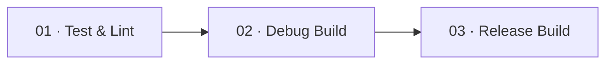

<div align="center">

# 🔐 Nexus SSH

### A modern, secure, native Android SSH client — terminal, SFTP, Docker & systemd in your pocket.


</div>

---

## ✨ What is Nexus SSH?

**Nexus SSH** is a fully native Android app (100% Kotlin + Jetpack Compose) that lets you manage Linux servers straight from your phone. Connect over SSH, run commands in a real PTY shell, browse and edit remote files over SFTP, watch live server metrics, and control Docker containers and systemd services — all with credentials encrypted by the hardware-backed Android Keystore.

> 💡 No demo data, no mock screens: everything you see in the app comes from your real server.

---

## 🚀 Features

| | Feature | Details |
|---|---|---|
| 🏠 | **Home dashboard** | Greeting, connected-server count, quick-access tiles and one-tap connect |
| 🖥️ | **Multi-server profiles** | Unlimited saved servers (Room), custom icons, edit / delete from a drawer-style manager, favourite folders |
| 🔑 | **Password & private-key auth** | RSA / ED25519 / ECDSA keys (OpenSSH or PEM), optional passphrase, import key from a file |
| 🛡️ | **Hardware-backed encryption** | Credentials encrypted with AES-256-GCM via Android Keystore, never stored in plaintext |
| 🔍 | **Host-key verification (TOFU)** | Shows the real `SHA256:` fingerprint on first connect, pins it, and **refuses** a changed key |
| ⌨️ | **Interactive terminal** | Real PTY shell, type directly like a normal terminal, **multiple tabs**, sticky CTRL / ALT, key bar pinned above the keyboard, copy / paste |
| 📁 | **SFTP file manager** | Grid / list view, breadcrumbs, search, upload, download, create, edit text files, delete |
| 📊 | **System monitor** | Live CPU, memory, disk and network charts from real samples, selectable time range, tap-to-inspect |
| 🐳 | **Docker manager** | Container list, start / stop / restart, details and logs |
| ⚙️ | **systemd services** | Search, filter (running / stopped / failed), start / stop / restart with confirmation |
| 🌐 | **Built-in browser** | Open any web app installed on the server (Portainer, Grafana, Jellyfin, Jupyter…) through a secure SSH tunnel, detected ports, bookmarks, "Open in browser" for Docker ports |
| 🧮 | **Process manager** | Live process list sorted by CPU or memory, search, terminate or force-kill with confirmation |
| ⚡ | **Snippets** | Save the commands you use often and run them in the terminal with one tap |
| 🧩 | **Launcher home** | Android-style icon grid you can rearrange by touching, holding and dragging, plus an A-Z app drawer with search |
| 📜 | **Log viewer** | journald / syslog, kernel, SSH and any custom log file with live filtering |
| 🔒 | **App lock** | Optional biometric / device-credential lock and screenshot protection |
| 🎨 | **Theming** | Warm ivory / forest-green design, generated wave wallpaper, accent colours, Geist + Bricolage typography and Phosphor icon assets |

> ℹ️ One server is connected at a time; all other saved servers stay one tap away.

---

## 🛠️ Getting Started

### ✅ Prerequisites

- 🧑‍💻 **Android Studio** Ladybug (2024.2) or newer
- ☕ **JDK 17** (bundled with recent Android Studio)
- 📱 An Android device or emulator running **Android 8.0+**
- 🖧 A Linux server you can reach over SSH to test with

### 📥 1. Clone

```bash
git clone https://github.com/Karannkx/nexus-ssh.git
cd nexus-ssh
```

### ▶️ 2. Run from Android Studio

1. Open the project folder in Android Studio.
2. Let Gradle sync finish.
3. Pick a device/emulator and press **Run ▶**.

### 🏗️ 3. Build from the command line

> ℹ️ The repository uses the installed Gradle 8.10.2 command in CI. The Gradle wrapper is not committed yet. Install [Gradle 8.10.2](https://gradle.org/releases/) locally, or open the project in Android Studio and use its Gradle integration. A first clean build needs network access to fetch the bundled open-source font files.

```bash
# Unit tests + Android lint + Debug APK
gradle :app:testDebugUnitTest :app:lintDebug :app:assembleDebug

# Debug APK output:
# app/build/outputs/apk/debug/app-debug.apk
```

Install on a connected device:

```bash
adb install -r app/build/outputs/apk/debug/app-debug.apk
```

> 📦 The debug build uses the package id `com.nexus.ssh.debug`, so it can live next to a release build.

### 🤖 4. CI/CD pipeline (GitHub Actions)

The workflow is split into three connected jobs. GitHub Actions displays them as separate boxes connected by `needs` dependencies:



- **Test & Lint** runs the JVM unit tests and Android lint, then uploads reports.
- **Debug Build** runs only after verification succeeds and uploads `nexus-ssh-debug-apk`.
- **Release Build** runs only for version tags such as `v1.0.1`, after the debug build succeeds; it uploads `nexus-ssh-release-apk` and publishes a GitHub Release.

On ordinary pushes and pull requests, the pipeline stops after the Debug Build. To create a release, push a version tag:

```bash
git tag v1.0.1
git push origin v1.0.1
```

Open the **Actions** tab → latest workflow run → **Artifacts** to download the APK and test/build logs.

**Kotlin DSL font download:** The font task imports `URL`, `HttpURLConnection` and `InputStream` explicitly and uses a typed connection, avoiding Gradle Kotlin DSL's `java` accessor shadowing `java.net` and the resulting unresolved references.\n\n**Android SDK note:** CI installs only `platform-tools`. The old standalone SDK package named `tools` has been removed from Google's SDK repository; command-line tools are installed by the setup action, and Android Gradle Plugin resolves the required platform/build-tools packages.

**Signing note:** The current `release` build type still uses the Android debug signing configuration for test distribution. Configure a private upload keystore through GitHub Secrets before publishing to Google Play. Never commit a keystore or passwords to the repository.

---

## 📖 How to use

1. ➕ Tap **+** and add a server (host, port, username, password *or* private key).
2. 🔌 Tap **Connect**.
3. 🔍 On first connection, compare the displayed **fingerprint** with your server's and tap **Trust & connect**.
4. 🎉 Use the bottom tabs to monitor, run commands, edit files, and manage Docker / services.

> 🔎 Tip — verify a server fingerprint with:
> `ssh-keygen -lf /etc/ssh/ssh_host_ed25519_key.pub`

---

## 🗂️ Project Structure

```text
nexus-ssh/
├── .github/workflows/build-apk.yml      # CI: builds the debug APK (+ release on tags)
├── app/src/main/
│   ├── java/com/nexus/ssh/
│   │   ├── MainActivity.kt              # Activity, NavHost, floating nav, app lock, dialogs
│   │   ├── NexusViewModel.kt            # State + every server action (SSH, SFTP, Docker, logs…)
│   │   ├── core/
│   │   │   ├── database/                # Room: ServerEntity, ServerDao, NexusDatabase
│   │   │   ├── prefs/                   # AppPrefs (settings, favourites, server icons)
│   │   │   ├── security/                # KeystoreManager (AES-256-GCM)
│   │   │   ├── ssh/                     # Connection, PTY session, terminal buffer, parsers
│   │   │   └── sftp/                    # SftpManager (list, edit, upload, download)
│   │   └── ui/
│   │       ├── Theme.kt, Icons.kt       # Geist / Bricolage typography, Phosphor + custom icons
│   │       ├── components/              # Nav bar, cards, charts, illustrations
│   │       └── screens/                 # Home, Servers, Files, Monitor, Terminal, Docker,
│   │                                    # Services, Logs, Apps, Settings, dialogs
│   └── res/                             # Wallpaper, splash art, theme resources
├── THIRD_PARTY_NOTICES.md               # Font and icon attribution / licenses
├── build.gradle.kts
└── settings.gradle.kts
```

---

## 🔒 Security

- 🔐 Secrets are encrypted with a non-exportable **AES-256-GCM** key stored in the Android Keystore.
- 🚫 Backups are disabled; the database and preferences are excluded from cloud backup and device transfer.
- 🧬 Host keys are pinned with **trust-on-first-use**; a changed key is a hard failure, not a prompt.
- 🧹 Remote commands built from user-visible data (container IDs, unit names) are validated and quoted.

Found a vulnerability? Please **don't** open a public issue — contact the maintainer privately via the email on the GitHub profile.

---

## 🗺️ Roadmap

- [ ] 🔀 SSH port forwarding / tunnels
- [ ] 🗝️ Generate SSH keys in-app
- [ ] 🖼️ Full-screen terminal emulation (vim, htop, tmux)
- [ ] 🔗 Several simultaneous server connections
- [ ] 🧪 Unit & UI tests

Have an idea? [Open an issue](https://github.com/Karannkx/nexus-ssh/issues) 💬

---

## 🤝 Contributing

Contributions are **very welcome** — from typo fixes to whole features! 🎉

1. 🍴 **Fork** the repository
2. 🌿 **Create a branch**
   ```bash
   git checkout -b feature/amazing-feature
   ```
3. 💻 **Make your changes** and make sure it builds:
   ```bash
   gradle :app:assembleDebug
   ```
4. ✅ **Commit** with a clear message
   ```bash
   git commit -m "feat: add amazing feature"
   ```
5. 🚀 **Push** and open a **Pull Request** against `main`
   ```bash
   git push origin feature/amazing-feature
   ```

### 📝 Guidelines

- Follow the official [Kotlin coding conventions](https://kotlinlang.org/docs/coding-conventions.html).
- Keep UI in Compose and logic in the `ViewModel` / `core` packages.
- Never commit secrets, keys, or real server addresses.
- Use [Conventional Commits](https://www.conventionalcommits.org/) (`feat:`, `fix:`, `docs:` …) where possible.
- For big changes, open an issue first so we can discuss the approach.

### 🐛 Reporting bugs

Please include your Android version, device model, what you expected vs. what happened, and (without secrets!) any relevant logcat output.

---

## 🎨 Design system

- **Geist Sans** is used for general UI text and controls.
- **Geist Mono** is used for terminal output, IP addresses, paths and other technical values.
- **Bricolage Grotesque** is reserved for display and screen headings so it adds personality without hurting dense UI readability.
- **Phosphor Icons** are integrated through the Android artifact `com.adamglin:phosphor-icon-android:1.0.0` (`com.adamglin.PhosphorIcons` API) for the primary navigation and server identity icon set; legacy Material glyphs remain only where a screen-specific symbol has not yet been migrated.
- Font binaries are downloaded at build time from the upstream Google Fonts repository into generated Android resources, then bundled locally in the APK. No font is fetched at runtime.
- See [`THIRD_PARTY_NOTICES.md`](THIRD_PARTY_NOTICES.md) for upstream sources and licenses.

## ⚠️ Limitations

- The terminal is line-oriented; full-screen TUI apps are not rendered correctly yet.
- The tag-triggered release APK currently uses the repository's debug signing config for test distribution. Replace `signingConfig` with your private release keystore before publishing to Play Store or distributing a production build.
- SFTP editing is limited to text files up to 1 MB.
- Docker / systemd actions require your user to have the needed permissions (or passwordless `sudo`).

---

## 📄 License

Released under the **MIT License** — see the [LICENSE](LICENSE) file for details.

---

<div align="center">

Made with ❤️ by [Karannkx](https://github.com/Karannkx)

⭐ **If you find Nexus SSH useful, please star the repo!** ⭐

</div>


### CI troubleshooting: Phosphor Compose icons

The Android target uses `com.adamglin:phosphor-icon-android:1.0.0`. Import the API as:

```kotlin
import com.adamglin.PhosphorIcons
import com.adamglin.phosphoricons.Regular
```

Do not import `com.adamglin.phosphoricons.PhosphorIcons`; that package path does not contain the top-level icon provider and causes `Unresolved reference: PhosphorIcons` during `compileDebugKotlin`. The CI preflight checks the artifact coordinate and imports before Gradle compilation.
